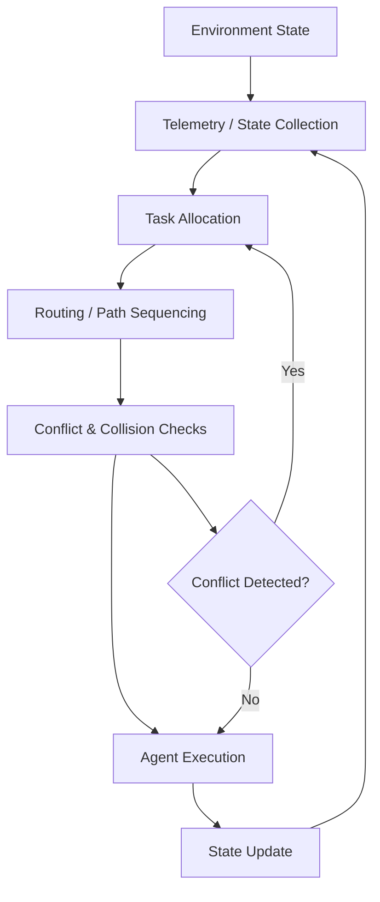

# PMARS — Personalized Multi-Agent Robotic System

> **A computational multi-agent robotics framework for adaptive task allocation, routing, conflict resolution, and failure-aware coordination in dynamic environments.**

[](https://www.python.org/)
[](#research)
[](#reproducibility)
[](LICENSE)

**PMARS is an independent computational robotics research project investigating how multiple autonomous agents can coordinate tasks efficiently while reducing conflicts and latency under dynamic workload conditions.**

> **Scope:** PMARS is evaluated in a 2D computational simulation. It does not constitute physical robotic validation.

---

## Research in 30 Seconds

|                       |                                                                                                                                                   |
| --------------------- | ------------------------------------------------------------------------------------------------------------------------------------------------- |
| **Research question** | How can autonomous agents coordinate efficiently in dynamic environments while minimizing latency and collisions under computational constraints? |
| **System**            | Multi-agent task allocation + routing + conflict resolution + telemetry feedback                                                                  |
| **Environment**       | 2D dynamic coordinate-grid simulation                                                                                                             |
| **Scale**             | Up to 100 concurrent simulated agents                                                                                                             |
| **Evaluation**        | 50-trial computational experiments with controlled random seeds                                                                                   |
| **Baselines**         | Random allocation / routing and greedy distance-based routing                                                                                     |
| **Primary metrics**   | Task latency, collision errors, task efficiency                                                                                                   |
| **Research approach** | Baseline comparison + ablation testing + failure analysis                                                                                         |
| **Validation scope**  | Computational simulation only                                                                                                                     |

---

# Table of Contents

* [Research](#research)
* [Why PMARS?](#why-pmars)
* [System Architecture](#system-architecture)
* [How PMARS Coordinates Agents](#how-pmars-coordinates-agents)
* [Experimental Methodology](#experimental-methodology)
* [Baselines](#baselines)
* [Results](#results)
* [Ablation Study](#ablation-study)
* [Failure Analysis](#failure-analysis)
* [Reproducibility](#reproducibility)
* [Repository Structure](#repository-structure)
* [Limitations](#limitations)
* [Future Work](#future-work)
* [Research Outputs](#research-outputs)
* [Citation](#citation)
* [Author](#author)

---

# Research

## Research Question

> **How can autonomous agents coordinate efficiently in dynamic environments while minimizing latency and collisions under physical and computational constraints?**

PMARS investigates this question through a controlled multi-agent simulation environment.

The project focuses on four interacting problems:

1. **Task allocation** — deciding which agent should execute which task.
2. **Path coordination** — selecting routes while considering the movement of other agents.
3. **Conflict resolution** — responding when independently planned movements create spatial conflicts.
4. **Dynamic recovery** — adapting assignments and movement when the environment changes.

The objective is not simply to make individual agents efficient.

The objective is to investigate whether **system-level coordination mechanisms improve collective behavior as the number of interacting agents increases.**

---

# Why PMARS?

A collection of individually efficient agents can still produce inefficient collective behavior.

When multiple agents operate simultaneously, local decisions can create:

* spatial conflicts
* queue congestion
* unnecessary travel
* task starvation
* deadlocks
* increased completion latency

PMARS therefore treats coordination as a **system-level problem** rather than optimizing each agent independently.

The research evaluates whether telemetry-aware coordination and conflict-resolution mechanisms can improve performance relative to simpler allocation and routing strategies.

---

# System Architecture



The system follows a feedback-oriented architecture:

**State → Decision → Execution → Feedback → Adaptation**

This allows the simulation to evaluate coordination mechanisms under changing task and spatial conditions.

---

# System Components

## 1. Telemetry / State Collection

The system maintains information about the simulated environment and active agents.

Relevant state includes information required for:

* agent position
* task state
* spatial occupancy
* routing decisions
* conflict checks
* workload conditions

The telemetry layer provides the information required by downstream coordination mechanisms.

---

## 2. Dynamic Task Allocation

Tasks are assigned to available agents according to the implemented allocation strategy.

The system considers the current simulation state rather than treating every task as an isolated assignment.

This enables task reassignment when system conditions change.

---

## 3. Routing

Agents execute movement through the simulated coordinate environment.

Routing decisions are evaluated in the context of:

* destination
* current agent state
* spatial constraints
* competing agents
* collision risk

---

## 4. Conflict Resolution

PMARS evaluates potential spatial conflicts during execution.

When conflicts occur, the system can modify coordination decisions rather than allowing agents to continue independently.

This component is particularly important in high-density environments, where individually reasonable paths can become collectively inefficient.

---

## 5. Feedback

After agent actions are executed, the resulting state is returned to the coordination layer.

This creates the feedback loop:

```text
Observe
   ↓
Decide
   ↓
Move
   ↓
Evaluate
   ↓
Adapt
   ↓
Repeat
```

---

# Experimental Methodology

PMARS is evaluated through controlled computational experiments rather than physical robotic deployment.

## Experimental protocol

The reported evaluation framework uses:

| Parameter                |                                   Configuration |
| ------------------------ | ----------------------------------------------: |
| Maximum simulated agents |                                         **100** |
| Experimental repetitions |                         **50 trials per setup** |
| Fixed random seeds       |                            `42, 7, 21, 99, 123` |
| Environment              |                              2D coordinate grid |
| Evaluation               |                   Automated experiment pipeline |
| Primary metrics          | Task latency, collision errors, task efficiency |
| Evaluation type          |                        Computational simulation |

The experiment runner is:

```text
run_experiments.py
```

where available in the repository.

---

# Baselines

PMARS is evaluated against simpler coordination strategies.

## Random Allocation / Routing

Tasks or destinations are assigned without using the full coordination strategy.

This provides a low-complexity reference point for measuring the value of coordinated decision-making.

## Greedy Routing

Agents select destinations based primarily on local distance or immediate routing considerations without the full dynamic coordination mechanism.

This provides a comparison against individually efficient but less globally coordinated behavior.

---

# Results

The following results are the reported results of the PMARS experimental framework.

> **Important:** Results should be interpreted as simulation measurements within the defined computational environment.

## Primary Results

| Metric                                      |     PMARS Result |
| ------------------------------------------- | ---------------: |
| Average task latency                        |  **7.8 ± 0.4 s** |
| Concurrent simulated agents                 |          **100** |
| Task efficiency improvement vs. greedy      | **+38.4 ± 2.2%** |
| Collision-rate reduction vs. random routing | **−27.2 ± 3.1%** |

The reported ± values represent sample standard deviation across the evaluation trials where specified.

---

# Ablation Study

Ablation experiments remove individual coordination mechanisms to investigate their contribution to overall behavior.

## Reported 50-Trial Results

| Configuration                 | Avg. Task Latency | Collision Errors |
| ----------------------------- | ----------------: | ---------------: |
| **Full PMARS**                |   **7.8 ± 0.4 s** |      **8 ± 1.2** |
| No telemetry bounds check     |            11.2 s |               34 |
| No conflict-resolution module |            10.4 s |               12 |

### Interpretation

Removing telemetry bounds checking increased reported latency from **7.8 s to 11.2 s**, while collision errors increased from approximately **8 to 34**.

Removing the conflict-resolution module increased reported latency to **10.4 s** and increased collision errors to approximately **12**.

These ablations suggest that the coordination and monitoring mechanisms contribute to the observed performance of the complete system.

They do **not**, by themselves, establish that the same performance would occur on physical robots.

---

# Failure Analysis

A major part of PMARS is identifying conditions where the coordination strategy begins to degrade.

## High Task Arrival Rates

The system exhibits queue bottlenecks under extreme simulated workloads.

A reported stress condition occurs above approximately:

```text
> 300 tasks / minute
```

under the corresponding simulation configuration.

This indicates that coordination quality is not independent of task arrival rate.

---

## High Agent Density

The simulation exhibits increasingly difficult local routing behavior as agent density rises.

A reported degradation threshold occurs around:

```text
0.75 agents / coordinate unit
```

under the evaluated configuration.

At higher densities, local routing conflicts can produce spatial deadlocks.

---

## What These Failures Tell Us

The failure cases are important because they demonstrate that PMARS is not being evaluated only under favorable conditions.

Instead, the experiments investigate the boundary between:

**stable coordination**

and

**coordination breakdown.**

This provides a direction for future research into adaptive congestion control and distributed recovery.

---

# Reproducibility

The project is designed around reproducible computational experiments.

## Experiment pipeline

```text
Research Question
       ↓
Configuration
       ↓
Simulation
       ↓
Raw Results
       ↓
Statistical Analysis
       ↓
Figures / Tables
       ↓
Interpretation
```

The repository contains the implementation and experiment infrastructure required to reproduce the computational evaluation, subject to the environment and dependencies documented in the repository.

## Random seeds

The reported experiments use:

```text
42
7
21
99
123
```

Fixed seeds reduce variation caused by random initialization and allow controlled comparisons between configurations.

## Recommended setup

```bash
git clone https://github.com/mmu3840-Zenith/-PMARS-Multi-Agent-Robotic-System.git

cd -PMARS-Multi-Agent-Robotic-System

python -m venv .venv
```

### Windows

```powershell
.venv\Scripts\Activate.ps1
```

### macOS / Linux

```bash
source .venv/bin/activate
```

Install dependencies:

```bash
pip install -r requirements.txt
```

Run the primary simulation using the repository's documented entry point.

For the full experimental benchmark, use:

```bash
python run_experiments.py
```

if the script is present in the current repository version.

---

# Repository Structure

The project is organized around simulation, experimentation, analysis, and research documentation.

```text
.
├── docs/
├── paper/
├── visuals/
├── src/
├── experiments/
├── analysis/
├── results/
├── tests/
├── main.py
├── requirements.txt
├── run_experiments.py
├── README.md
└── LICENSE
```

> The exact structure may vary between repository versions. See the repository tree for the current implementation.

---

# Evaluation Metrics

PMARS evaluates system behavior using quantitative metrics.

## Task Efficiency

A measure of completed work relative to the simulation's execution process.

## Collision Rate

Collision or conflict events normalized according to the experiment configuration.

## Task Latency

The time required for an assigned task to reach completion within the simulation.

## Stabilization Time

The number of simulation steps required for system behavior to return to the defined stability condition.

## Failure Rate

The proportion of agents or tasks that fail according to the experiment's defined failure conditions.

The exact implementation of each metric should be interpreted according to the corresponding analysis code.

---

# Computational Complexity

PMARS contains multiple operations with different computational costs.

Complexity should therefore be interpreted **per component rather than as a single complexity value for the entire system**.

Where complexity is discussed in the accompanying research documentation, it refers to the specific operation being analyzed rather than implying that the entire simulation has one uniform asymptotic complexity.

---

# Limitations

PMARS is intentionally a computational model.

## 1. 2D Environment

The simulation operates on a 2D coordinate environment rather than a physical 3D workspace.

## 2. Simplified Physics

The model does not reproduce the full physical dynamics of robotic systems.

It does not model all effects associated with:

* motor friction
* actuator backlash
* mechanical deformation
* aerodynamic effects
* physical inertia

## 3. Sensor Assumptions

The simulation uses simplified state information and does not reproduce the full uncertainty of physical sensors.

Real robotic systems would experience:

* localization error
* sensor noise
* occlusion
* calibration errors
* actuator uncertainty

## 4. Communication Model

Network communication is represented using a simplified computational model rather than complete physical networking behavior.

Real systems may experience:

* packet loss
* variable latency
* disconnections
* bandwidth constraints

## 5. Physical Validation

No physical robot deployment is demonstrated by this repository.

Therefore, the reported results should be interpreted as **simulation evidence**, not proof of real-world robotic performance.

---

# Research Scope

## Demonstrated

PMARS demonstrates a computational framework for investigating:

* multi-agent coordination
* task allocation
* dynamic routing
* conflict resolution
* workload stress
* failure behavior
* ablation-based evaluation

## Not Demonstrated

The project does not establish:

* physical robotic deployment
* real-world sensor robustness
* real-world actuator performance
* industrial deployment
* guaranteed scalability to physical robot fleets

## Future Validation

A future implementation could evaluate the coordination architecture in increasingly realistic environments.

---

# Future Work

The next stage of PMARS would move from abstract simulation toward higher-fidelity robotic experimentation.

### Stage 1 — Higher-Fidelity Simulation

Introduce:

* sensor noise
* actuator constraints
* stochastic communication delays
* packet loss
* more realistic dynamics

### Stage 2 — Robotics Middleware

Investigate integration with environments such as:

* ROS 2
* Gazebo
* Isaac Sim

### Stage 3 — Hardware Validation

Evaluate the coordination mechanisms using physical robotic platforms.

### Stage 4 — Distributed Coordination

Investigate whether portions of the supervisory architecture can be decentralized while maintaining system stability.

These are **future research directions**, not capabilities demonstrated by the current repository.

---

# Research Outputs

The repository is part of a broader independent research program investigating adaptive multi-agent intelligence.

Related work includes:

* **NanoSwarm — Tissue Reconstruction Simulation**
* **Allocation & Resource Optimization Engine**
* **Supervisory AI System**

PMARS serves as the primary coordination-focused project within that research direction.

---

# Documentation & Research Materials

Relevant research materials are available within the repository:

* [`paper/`](paper/)
* [`docs/`](docs/)
* [`visuals/`](visuals/)

Where available, these directories contain supporting research documentation, visualizations, and experimental material.

---

# Citation

If you use PMARS in academic or technical work, please cite the associated research manuscript when a formal citation is available.

A machine-readable citation file can be added to this repository once the final bibliographic metadata is established.

---

# License

This project is distributed under the license contained in [`LICENSE`](LICENSE).

---


> *Building adaptive multi-agent robotic systems for coordination, optimization, and resilient autonomous behavior.*

---

## Research Philosophy

PMARS is built around a simple principle:

> **A system should be evaluated not only by how well it performs, but by how clearly we can understand its behavior, reproduce its results, and identify where it fails.**

The project therefore treats **reproducibility, baseline comparison, ablation testing, and failure analysis** as core parts of the research rather than optional documentation.

---

**Status:** Active research project
**Evaluation:** Computational simulation
**Primary domain:** Multi-agent robotics / autonomous systems
